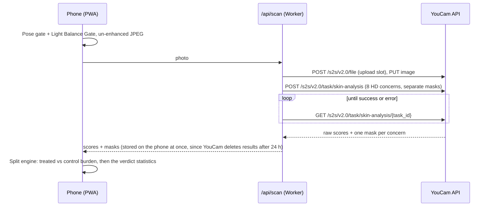
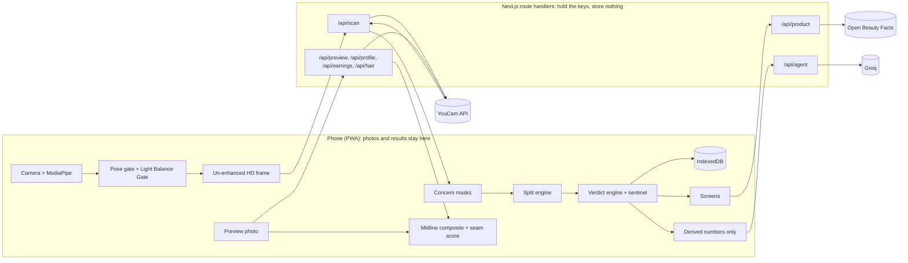

<div align="center">


# SplitSide

### Your face is the control group.

**Measure what works. Preview before you buy. Always half-and-half, always honest.**

[](https://splitside.zen-web.workers.dev)
[](https://youtu.be/FYrJWxnps3M)
[](https://youcam-api-skin-ai-ecommerce.devpost.com/)

      

<a href="https://youtu.be/FYrJWxnps3M"></a>

[**Live app**](https://splitside.zen-web.workers.dev) · [**Film**](https://youtu.be/FYrJWxnps3M) · [**How it works**](#how-it-works) · [**YouCam usage and proof**](#youcam-api-usage-and-proof) · [**Setup**](#setup) · [**Docs**](docs/)

An at-home split-face skincare trial app, built on the YouCam API for the Skin AI track of the [YouCam API Skin AI & eCommerce VTO Hackathon](https://youcam-api-skin-ai-ecommerce.devpost.com/).

</div>

---

## Watch the film

<div align="center">
<a href="https://youtu.be/FYrJWxnps3M"></a>

**[▶ Watch the 2:52 film on YouTube](https://youtu.be/FYrJWxnps3M)** (or [play it from Cloudflare](https://splitside-media.zen-web.workers.dev)): problem, method, the real app on a phone, and the verdict.
</div>

## The problem

People buy skincare without knowing whether it works. Before-and-after selfies can't tell them: a bad night or a cloudy window changes a skin score more than most products do.

Dermatology solved this long ago with the **split-face trial**, where one side of the face is the control. SplitSide brings that method home:

1. A coin flip picks a cheek. The product goes there only.
2. Every couple of days, one guided selfie. **YouCam AI Skin Analysis** measures both halves of that same photo.
3. Light, sleep, stress and weather hit both sides equally, so they cancel out. What's left is the product.

The answer is **Working, No real difference, or Stop**, delivered before the store's return window closes.

## How it works

Every clip below comes from the real app, recorded on a phone emulator with live YouCam calls.

| 1 · The problem | 2 · The method |
|---|---|
|  |  |
| Before-and-after selfies measure your week, not the product. | One cheek gets the product, the other is the control. Life cancels out. |

| 3 · Plan a trial | 4 · Guided capture |
|---|---|
|  |  |
| Product, goals and return deadline. A coin flip picks the treated cheek. | Face landmarks line up every photo. The Light Balance Gate blocks uneven light. |

| 5 · YouCam masks, split at the midline | 6 · Baseline |
|---|---|
|  |  |
| One HD mask per concern, cut into treated and control areas. | Three scans learn how your cheeks already differ: your personal noise band. |

| 7 · Day 15 verdict | 8 · Irritation sentinel |
|---|---|
|  |  |
| Statistics decide: the treated cheek beat the noise band twice in a row. | Redness rising on the treated side only? Stop today, with clear advice. |

| 9 · Trial assistant | 10 · Half-face shade swatch |
|---|---|
|  |  |
| An LLM with tools over your numbers. It explains them and never makes them up. | Skin tone and Fitzpatrick type shortlist shades. Try one on half your face. |

| 11 · Hair colour and SplitHair | 12 · Keep or return |
|---|---|
|  |  |
| Two colours, one per side. Even frizz, measured side by side. | Keep what works. Return what doesn't, before the window closes. |

### More of the app

| Onboarding | A trial, start to verdict | Irritation stop |
|---|---|---|
|  |  |  |

| Money saved | Light and dark themes | Landing page |
|---|---|---|
|  |  |  |

| Home | Scanner | Verdict | Preview | Assistant | Dark |
|---|---|---|---|---|---|
|  |  |  |  |  |  |

The film and the 12 clips above show the maker's own face, used with consent. The day-15 results come from the app's seeded trial, which the app labels "Demo data". The smaller recordings use demo data and no real faces. All media is served from Cloudflare at [`splitside-media.zen-web.workers.dev`](https://splitside-media.zen-web.workers.dev).

**Try it without a camera:** open the app and tap *Explore a demo trial*.

## Features

### Measure: real trials on your face

- **Guided scanner.** Live MediaPipe face landmarks check centring, head pose, distance, and eyes and mouth, against a ghost outline of your first scan. Auto-captures after 0.6 s of passing every check.
- **Light Balance Gate.** Compares median brightness of the two cheeks before upload and blocks side light, darkness, glare and blur.
- **Voice guidance.** Optional spoken prompts during capture, for accessibility.
- **Split engine.** Fits the facial midline and builds two mirror-image cheek areas of equal size, with a buffer band for product spreading. Then measures how much of each area every YouCam concern mask covers.
- **Statistics, not vibes.** Three baseline scans give your personal noise range. A difference-in-differences verdict adds confidence, early stopping, and a 7-day extension if the return window allows.
- **Irritation sentinel.** Redness or breakouts rising on the treated side only, or reported burning or stinging, trigger an immediate Stop with safety advice. The threshold is lower for Fitzpatrick IV–VI with strong actives.
- **Measured skin type.** YouCam reads your Fitzpatrick type from a photo. You can always change it.
- **Head-to-head.** Budget dupe on one cheek, premium original on the other.
- **Makeup wear test.** "Does this foundation break me out?" Seven days on one half, against the bare half.
- **SplitHair (beta).** An anti-frizz product on one side of your parting, rated per side. Confidence stays low by design: frizz has only 4 levels.
- **Context that cancels out.** Log sleep, stress and your cycle, and optionally pull humidity and air quality. A chart shows these moving your whole-face score while the treated-vs-control line ignores them.

### Preview: before you buy

Half simulated product, half the real you, in one photo. Always labelled *Preview: simulated*, never counted as a measurement.

- **Foundation shade swatch.** Your skin tone, measured by YouCam, shortlists 3 of 24 generic shades. Then see one shade next to bare skin, or two side by side. A seam score (CIEDE2000) says "Blends well", "Slightly light" or "Too dark", so you buy one shade instead of two.
- **Half-head hair colour.** A new colour on one side of your head, with suggestions that explain why they suit your undertone.
- **Gold or silver?** One metal on each ear in the same photo.
- **Claim Check.** The box's promise simulated on your own baseline photo, next to what your scans measured.

### Decide: what to do next

- **Keep or return.** A return countdown, and a ready-to-send return request with your trial evidence.
- **Money saved.** Refunds plus the premium products you didn't need, using the prices you typed.
- **Skin Passport.** Ingredient patterns across your trials, and a pre-purchase check on any ingredient list.
- **Trial assistant.** An LLM agent with tools over your numbers. It explains the verdict, drafts messages, and replies in your language. It never sees photos and can't invent or override a measurement.
- **Barcode fill.** Scan a product to fill in its name and ingredients.
- **Dermatologist report.** A one-page printable summary of the trial.
- **Calendar export.** Every scan day, as one calendar file.
- **Privacy-safe sharing.** A result card and a 7-second reel from real photos, with eyes always pixelated and your room blurred on a copy.
- **Evidence board.** How pooled anonymous results would look per product and skin type. It shows example data, clearly labelled, today.

### Feel: a finished product

- Sage design system with **light and dark themes**, applied before first paint so there's no flash
- **GSAP motion**: a scrubbed scroll story on the landing page, verdict reveals, coin flip, page entrances. All of it respects reduced-motion settings, and it stays off the live scanner so face tracking keeps its frame budget
- **Installable PWA** with an offline shell
- **No accounts.** Everything lives on your phone. That's deliberate: nothing to sign in to, no profile to hand over

## APIs and integrations

### YouCam (9 APIs)

Every API has a real recorded response in [`tests/fixtures/youcam/`](tests/fixtures/youcam), checked by tests.

| API | Endpoint (`/s2s/v2.0/task/…`) | Why SplitSide uses it |
|---|---|---|
| **AI Skin Analysis (HD)** | `skin-analysis` | The measuring instrument. One mask per concern, split at the midline, rather than only reading whole-face scores |
| **AI Skin Simulation** | `skin-simulation` | Claim Check |
| **Makeup VTO** | `makeup-vto` | Half-face foundation swatch |
| **Hair Color VTO** | `hair-color` | Half-head colour preview |
| **Earrings VTO** | `2d-vto/earring` | Gold on one ear, silver on the other |
| **Skin Tone Analysis** | `skin-tone-analysis` | Shade and hair-colour shortlists, undertone |
| **Fitzpatrick Skin Type** | `fitzpatrick-scale-analyzer` | Tunes the irritation threshold |
| **Hair Frizziness Detection** | `hair-frizziness-detection` | SplitHair (beta) |
| **Photo Background Blur** | `bg-blur` | Share card, on a copy only |

The file upload (`POST /s2s/v2.0/file` plus presigned PUT) and credit endpoints support all of these.

**Deliberately not used on analysis photos:** lighting, colour correction, enhancement, face reshape or any beauty filter. Those would fake the measurement. Aging simulation and face swap are excluded too.

A finding worth sharing: **HD masks are display overlays, not plain alpha maps.** Undetected pixels are a grey `#3D3D3D` dimming layer, and detections are coloured with alpha on a per-concern scale. See [`lib/split/burden.ts`](lib/split/burden.ts) and [`docs/05-youcam-api-reference.md`](docs/05-youcam-api-reference.md).

### YouCam API usage and proof

Every number SplitSide shows comes from a real YouCam call. Here is how to check that.

| Proof | Where |
|---|---|
| **10 recorded real responses**, one per API plus an error case, each parsed by a test | [`tests/fixtures/youcam/`](tests/fixtures/youcam) · [`tests/youcamFixture.test.ts`](tests/youcamFixture.test.ts) |
| **Real HD concern masks** saved from a live skin-analysis task and used by the split-engine tests | [`tests/fixtures/youcam/cheeks-hd/masks`](tests/fixtures/youcam/cheeks-hd/masks) · clip 5 above |
| **Live account balance** on 2 Nov 2026 from `GET /s2s/v1.0/client/credit`: 364 units left on the 1,000-unit hackathon grant, plus a 40-unit token | The in-app dev panel calls [`/api/credits`](app/api/credits/route.ts) |
| **The key stays on the server.** Route handlers proxy every call, and the key was checked to be absent from the built client bundle | [`lib/youcam/client.ts`](lib/youcam/client.ts) · [`app/api/`](app/api) |
| **Live in production** on Cloudflare Workers, with keys set as Worker secrets | [splitside.zen-web.workers.dev](https://splitside.zen-web.workers.dev) |

How a scan uses the API:



### Third-party

| Service | Used for | Key needed |
|---|---|---|
| [Groq](https://groq.com) | Trial assistant (OpenAI-compatible tool calling) | Yes, optional: without it, answers come from the deterministic engine |
| [Open Beauty Facts](https://world.openbeautyfacts.org) | Barcode to product name and ingredients | No |
| [Open-Meteo](https://open-meteo.com) | Humidity, UV and air quality per scan, opt-in, location rounded to about 10 km | No |
| [MediaPipe](https://ai.google.dev/edge/mediapipe) | Face landmarks in the browser, self-hosted | No |

## Architecture



### The maths in one paragraph

For each concern, burden is the strength-weighted share of a cheek area that the mask covers. The asymmetry index is `A = ln((burden_treated + ε) / (burden_control + ε))`. Three baseline scans give `A0` and `sd` (floored at 0.05), so the smallest detectable change is `SDC = 1.96·√2·sd`. After baseline, `Δ = A − A0`. **Working** means the mean of the last two Δ is ≤ −SDC with both ≤ −0.75·SDC. **Worse** is the mirror case. **No difference** applies at the planned end with |mean Δ| < SDC. **Stop** applies whenever the sentinel fires. Full details are in [`docs/07-algorithms.md`](docs/07-algorithms.md).

### Project layout

```
app/                 screens + route handlers
components/          SplitPreview, ScannerFrame, charts, CheckIn, motion, landing/…
lib/split/           midline fit, face-frame ROIs, mask decoding and burden
lib/capture/         pose gate, Light Balance Gate, MediaPipe, voice guidance
lib/stats/           asymmetry, baseline/SDC, verdict, sentinel
lib/preview/         CIELAB + CIEDE2000, split composite, seam score, shade and hair shortlists
lib/trial/           planning, explanations, orchestrator, money saved
lib/agent/           system prompt, tools, tool loop, safety guard, drafts
lib/hair/            SplitHair model and ordinal verdict
lib/integrations/    Open Beauty Facts, Open-Meteo
lib/youcam/          client, generic task layer, schemas, parser, errors
tests/               unit tests + recorded fixtures
docs/                product spec, algorithms, API reference, plan
```

## Setup

Requires Node 22+.

```bash
git clone https://github.com/LSUDOKO/SplitProof.git
cd SplitProof
npm install
cp .env.example .env         # then fill in the keys
npm run dev                  # http://localhost:3000
```

| Variable | Required | Purpose |
|---|---|---|
| `YOUCAM_API_KEY` | For real scans and previews | YouCam console → API Keys. Server only |
| `YOUCAM_BASE_URL` | No | Defaults to `https://yce-api-01.makeupar.com` |
| `GROQ_API_KEY` | No | Trial assistant; falls back to engine text without it |
| `GROQ_MODEL` | No | Defaults to `openai/gpt-oss-120b` |

The demo works with no keys. The camera needs HTTPS on phones: use the Cloudflare deployment, or `npx next dev --experimental-https` on your LAN.

```bash
npm test                     # unit tests: no network, no units spent
npm run lint
npm run build
node scripts/record-gifs.mjs # re-record README GIFs (needs the dev server on :3100)
```

### Deploy (Cloudflare Workers)

The app runs on Cloudflare Workers through [OpenNext](https://opennext.js.org/cloudflare). Log in once with `npx wrangler login`, then:

```bash
npx wrangler secret put YOUCAM_API_KEY
npx wrangler secret put GROQ_API_KEY
npm run cf:deploy            # build + deploy; non-secret vars live in wrangler.jsonc
```

In development, `/dev/youcam` runs one photo through the full pipeline and shows the measured areas.

## Privacy and safety

- Photos go to YouCam only for analysis or a preview you asked for. YouCam deletes results within 24 hours. Everything else stays on the device.
- The assistant receives derived numbers and text, never images.
- API keys live only in server environment variables (verified absent from the built client bundle).
- Location is opt-in, rounded to about 10 km, and never stored.
- SplitSide is a cosmetic decision tool, not a medical device. Every Stop includes the advice to stop the product, rinse, use a plain moisturiser, and see a doctor if it is painful, spreading, blistering or not settling. The assistant's replies are checked in code to always include it.

## Known limits

- **Not yet proven on a real phone.** Camera capture has been exercised on an emulator fed with real face photos, not yet in a live scan session on a phone.
- **Thresholds** are the documented starting values and need calibration with more real scans.
- **SplitHair is beta.** The frizz API returns one level for three views, so SplitHair scores each side from a front view plus that side and its mirror image. Verified on real phone photos; frizz has only 4 levels, so it suits big changes.
- **The evidence board** shows example data. Pooling opt-in results needs a server store.
- **Barcode camera scanning** needs the browser's `BarcodeDetector` (Android Chrome). Typing the number works everywhere, and Open Beauty Facts doesn't know every product.
- **Earring images** are one museum hoop in two colours, not a retail catalogue.

## Roadmap

Crossover rounds, blinded A/B kits, a brand portal with Split Kits, pooled evidence, skin-tone equity reports, a store plugin, and a Hindi interface.

## Credits

Hoop photo: The Metropolitan Museum of Art, CC0. Product illustrations are original and unbranded. Skin measurements by YouCam AI (Perfect Corp).

## License

[MIT](LICENSE)

---

<div align="center">


**SplitSide** · [Live app](https://splitside.zen-web.workers.dev) · [Film](https://youtu.be/FYrJWxnps3M) · [Docs](docs/) · [Hackathon](https://youcam-api-skin-ai-ecommerce.devpost.com/)

<sub>A cosmetic decision tool, not a medical device. Skin measurements by YouCam AI (Perfect Corp).</sub>
</div>
