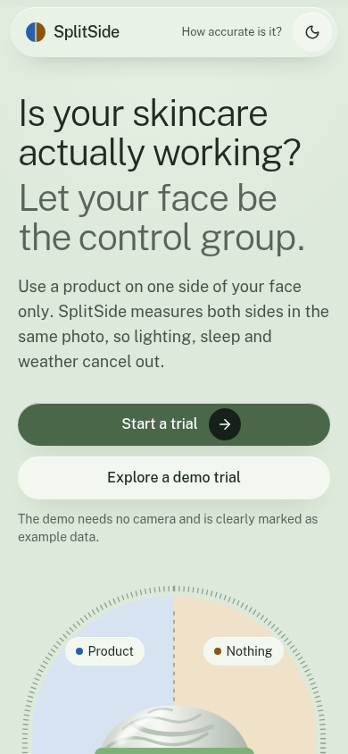
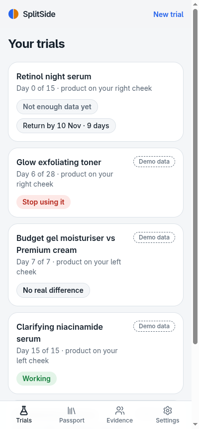
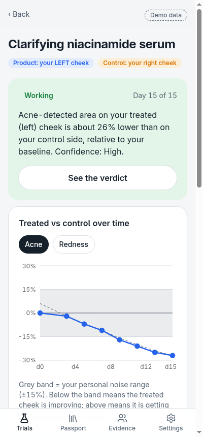
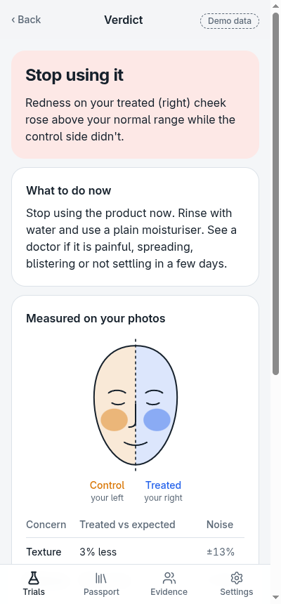
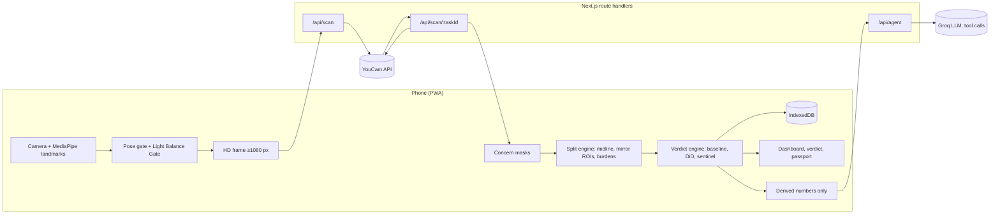

# SplitSide: your face is the control group

**Measure what works. Preview before you buy. Always half-and-half, always honest.**

SplitSide is an at-home **split-face skincare trial** app. You put a new product on one cheek only, and the other cheek stays untouched as the control. **YouCam AI Skin Analysis** then measures both halves in the same photo. Light, sleep, stress, weather and hormones hit both sides equally, so they cancel out. What's left is the product's real effect.

Built for the **YouCam API Skin AI & eCommerce VTO Hackathon** (Perfect Corp, Devpost), Skin AI track.

| Landing | Your trials | Trial dashboard | Irritation stop | Preview mode |
|---|---|---|---|---|
|  |  |  |  |  |

Demo video: _link added at submission_

## Why it exists

People buy skincare without knowing whether it works. Before-and-after selfies can't tell them, because a bad night or a cloudy window changes a skin score more than most products do. Dermatology solved this long ago with the split-face trial, where one side of the face is the control. SplitSide brings that method to shoppers. It answers "is this product working on my skin?" with **Working / No real difference / Stop**, before the store's return window closes.

## What it does

- **Guided capture.** Front camera with live MediaPipe face landmarks. Checks for centring, head pose, size and eyes/mouth, plus a ghost outline of your first scan. Auto-captures after 0.6 s of passing every check.
- **Light Balance Gate.** Compares the median brightness of the two cheek areas before anything is uploaded, and blocks side light, darkness, glare and blur.
- **Randomised side.** A cryptographic coin flip decides which cheek gets the product, so you can't pick your "better" side.
- **Split engine.** Fits the facial midline and builds two mirror-image cheek areas of equal size, with a buffer band down the middle. It then measures how much of each area every YouCam concern mask covers.
- **Statistics, not vibes.** Three baseline scans give your personal noise range (SDC). The difference-in-differences of the log treated/control ratio produces the verdict, with confidence, early stopping and a 7-day extension if the return window allows.
- **Irritation sentinel.** Redness or breakouts rising on the treated side only, or reported burning or stinging, mean an immediate STOP with safety advice. The threshold is lower for Fitzpatrick IV–VI with harsh actives.
- **Trial assistant.** An LLM agent with tools over your trial numbers. It explains the verdict, drafts the return request and suggests a gentler next trial. It never sees photos and never invents numbers. A deterministic manager runs the trial even without the LLM.
- **Claim Check.** YouCam AI Skin Simulation shows what the box's promise would look like on your own baseline photo, beside the measured result. It is clearly labelled as a simulation.
- **Preview mode ("split everything").** Before you buy, the product goes on half of you and the real you stays on the other half, in one photo, always labelled *Preview: simulated*:
  - **Half-face foundation swatch.** YouCam makeup try-on renders one or two shades. A seam score (CIEDE2000 between your bare cheeks and the same cheeks with the shade) says "Blends well", "Slightly light" or "Too dark", so you buy one shade instead of two. The shortlist comes from your skin tone measured by YouCam skin tone analysis.
  - **Half-head hair colour.** A new colour on one side of your head, your current colour on the other, with three suggestions that explain why they suit your undertone.
- **Measured skin type.** YouCam's Fitzpatrick analyser reads your phototype from one photo. Darker phototypes get an earlier irritation alert with strong actives, because they are more prone to dark marks after irritation.
- **Makeup wear test.** Foundation on one half for a week, measuring breakouts, redness and oiliness against the bare half. It answers "does this foundation break me out?" with the same engine.
- **Share card and story reel.** A PNG result card and a 7-second reel (day 0 → last day → verdict) built from your real photos. Eyes are always pixelated, and YouCam background blur hides your room on a copy of the photo.
- **Head-to-head mode.** Budget dupe on one cheek, premium original on the other.
- **Skin Passport.** Ingredient patterns across your trials, such as "fragrance appeared in 2 of your irritating products", plus a pre-purchase ingredient check.
- **Evidence board.** Pooled anonymous verdicts per product, split by skin type. It currently shows example data, clearly labelled.
- **Demo mode.** Four seeded trials (Working, Stop, Head-to-head no difference, early Stop), all badged **Demo data**. You can explore every screen without a camera.
- **Private by design.** Photos, masks and results live in IndexedDB on the phone. Delete everything takes one tap.

## YouCam APIs used, and why

| API | Endpoint | Why |
|---|---|---|
| File upload | `POST /s2s/v2.0/file` + presigned `PUT` | Registers the selfie and uploads the bytes server-side, so the key never reaches the browser |
| **AI Skin Analysis (HD)** | `POST /s2s/v2.0/task/skin-analysis`, `GET …/{task_id}` | 8 HD concerns (`hd_redness, hd_acne, hd_oiliness, hd_age_spot, hd_texture, hd_pore, hd_radiance, hd_moisture`) with `enable_mask_overlay: false`, so there is **one mask per concern**. The masks are the measuring instrument: SplitSide splits them at the midline instead of only reading whole-face scores. `raw_score` is stored for comparisons |
| **AI Skin Simulation** | `POST /s2s/v2.0/task/skin-simulation`, `GET …/{task_id}` | **Claim Check**: renders the brand's claimed improvement on your baseline photo ("What the brand promises", always labelled *Simulation*) next to what your scans actually measured. Never feeds the verdict |
| **Makeup VTO** | `POST /s2s/v2.0/task/makeup-vto` (foundation) | Half-face shade swatch. Composited at the facial midline with your bare half or a second shade; seam score computed client-side |
| **Hair Color VTO** | `POST /s2s/v2.0/task/hair-color` | Half-head hair colour preview |
| **Skin Tone Analysis** | `POST /s2s/v2.0/task/skin-tone-analysis` | Measured skin colour, undertone and hair colour, which drive the shade and hair shortlists |
| **Fitzpatrick Skin Type** | `POST /s2s/v2.0/task/fitzpatrick-scale-analyzer` | Phototype I–VI from a photo, which tunes the irritation-sentinel threshold |
| **Photo Background Blur** | `POST /s2s/v2.0/task/bg-blur` | Share card and reel, on a copy only |
| Credits | `GET /s2s/v1.0/client/credit` | Units panel in Settings |

Every API above has a real recorded response in [`tests/fixtures/youcam/`](tests/fixtures/youcam), validated by tests. A real HD response and its masks are recorded in [`tests/fixtures/youcam/cheeks-hd`](tests/fixtures/youcam/cheeks-hd), and the parser and mask decoder are tested against them. One finding: HD masks are **display overlays, not plain alpha maps**. Undetected pixels are a grey `#3D3D3D` dimming layer, and detections are coloured with alpha on a per-concern scale. The decoder handles this (see [`lib/split/burden.ts`](lib/split/burden.ts) and [`docs/05-youcam-api-reference.md`](docs/05-youcam-api-reference.md)).

Deliberately **not** used on analysis photos: lighting, colour correction, enhancement, face reshape or any beauty filter. Those would fake the measurement.

## Architecture



| Layer | Choice |
|---|---|
| App | Next.js 16 (App Router), TypeScript strict, Tailwind CSS v4, installable PWA |
| Face landmarks | `@mediapipe/tasks-vision` Face Landmarker, model and WASM self-hosted in `public/mediapipe` |
| Storage | IndexedDB via `idb`, on device only |
| Validation | Zod on every external payload (YouCam responses, agent requests) |
| Charts | Recharts |
| Assistant | Groq OpenAI-compatible chat completions with tool calling (`openai/gpt-oss-120b`), plain `fetch` |
| Tests | Vitest: 82 tests over pure modules and recorded fixtures |

```
app/                 screens + route handlers (api/scan, api/scan/[taskId], api/credits, api/agent)
components/          SplitFace, SplitPhoto, charts, CheckIn, AppShell…
lib/split/           midline fit, face-frame ROIs, mask decoding and burden
lib/capture/         pose gate, Light Balance Gate, MediaPipe wrapper, frame capture, YouCam polling
lib/stats/           asymmetry, baseline/SDC, verdict, sentinel, natural asymmetry
lib/trial/           planning, explanations, deterministic orchestrator
lib/agent/           system prompt, tools, tool loop, safety guard, drafts
lib/youcam/          client, schemas, parser, errors, concern sets
tests/               unit tests + fixtures/youcam (real recorded response)
docs/                product spec, algorithms, API reference, plan
```

### The maths in one paragraph

For each concern, burden = strength-weighted share of a cheek area that the mask covers. The asymmetry index is `A = ln((burden_treated + ε) / (burden_control + ε))`. Three baseline scans give `A0` and `sd` (floored at 0.05), so `SDC = 1.96·√2·sd`. After baseline, `Δ = A − A0`. The verdict is **Working** when the mean of the last two Δ is ≤ −SDC and both are ≤ −0.75·SDC. **Worse** is the mirror case. **No difference** applies at the planned end with |m| < SDC, and **Stop** whenever the sentinel fires. Full details are in [`docs/07-algorithms.md`](docs/07-algorithms.md).

## Setup

Requirements: Node 22+, npm.

```bash
git clone https://github.com/LSUDOKO/SplitProof.git
cd SplitProof
npm install
cp .env.example .env         # then fill in the keys
npm run dev                  # http://localhost:3000
```

| Variable | Required | Purpose |
|---|---|---|
| `YOUCAM_API_KEY` | for real scans | YouCam API key (console → API Keys). Server only |
| `YOUCAM_BASE_URL` | no | Defaults to `https://yce-api-01.makeupar.com` |
| `GROQ_API_KEY` | no | Trial assistant. Without it, answers fall back to the deterministic engine text |
| `GROQ_MODEL` | no | Defaults to `openai/gpt-oss-120b` |

The camera needs HTTPS on phones. Use a Vercel preview, or `npx next dev --experimental-https` on your LAN.

```bash
npm test            # unit tests (no network, no units spent)
npm run lint
npm run build
node --env-file=.env scripts/record-fixture.mjs photo.jpg   # record a new YouCam fixture (~16 units)
```

In development, `/dev/youcam` runs one photo through the full pipeline and shows the ROI overlay.

## Privacy and safety

- Photos go to YouCam only for analysis (YouCam deletes results within 24 h). Everything else stays on the device.
- The assistant receives derived numbers and text, never images.
- API keys live only in server environment variables (verified absent from the built client bundle).
- SplitSide is a cosmetic decision tool, not a medical device, and never diagnoses or treats anything. Every STOP includes the advice to stop the product, rinse, use a plain moisturiser, and see a doctor if it is painful, spreading, blistering or not settling. The assistant's replies are post-checked to always include it.

## Limitations and roadmap

- Thresholds are the documented starting values. They need calibration with more real scans.
- **Gold vs silver earrings (on hold).** The earring VTO call works and is recorded (`tests/fixtures/youcam/earring`). With our own drawn hoop images, though, the engine rendered the earrings as a few pixels, so we don't ship a preview we can't stand behind. It needs real product photos.
- **SplitHair frizz trial (dropped).** `hair-frizziness-detection` takes three views and returns one combined score, so there is no per-side value to compare.
- The Evidence board uses seeded example data. Pooling opt-in results needs a server store.
- Planned: crossover round, blinded A/B kits, brand portal, Hindi UI.

## License

[MIT](LICENSE)
